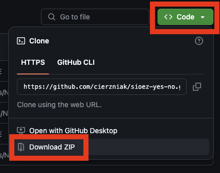
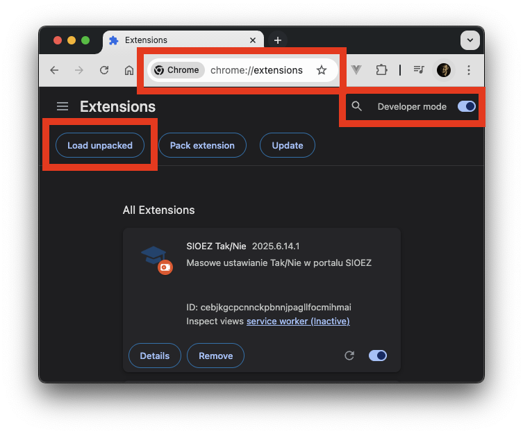
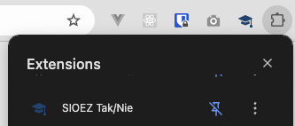
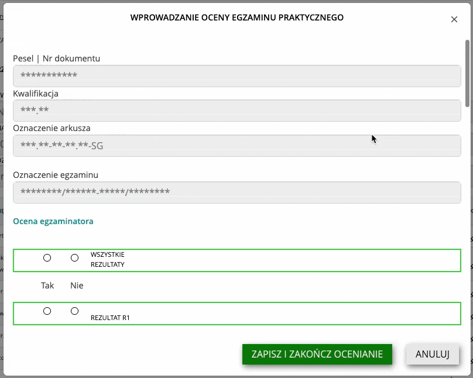

# SIOEZ Tak/Nie - wtyczka do Chromium

[](https://github.com/cierzniak/sioez-yes-no/actions/workflows/ci.yml)

Wtyczka do przeglądarek opartych o Chromium (Chrome, Edge, Brave) do automatycznego klikania Tak/Nie na stronie SIOEZ
([epkz.cke.edu.pl](https://epkz.cke.edu.pl/)) przy wprowadzaniu ocen z egzaminu praktycznego.

Testowane na SIOEZ w wersji `3.131.8`.

## Sposób instalacji

1. Pobierz plik `sioez-yes-no-<wersja>.zip` z [najnowszego wydania](https://github.com/cierzniak/sioez-yes-no/releases/latest)
   i rozpakuj w dowolnym miejscu (alternatywnie: pobierz całe repozytorium jako ZIP).



_na przykładzie Google Chrome_

2. Wejdź w [chrome://extensions/](chrome://extensions/)
3. Włącz Tryb deweloperski
4. Kliknij „Wczytaj rozpakowany” i wybierz katalog z rozpakowaną wtyczką (ten, w którym jest `manifest.json`)



Aktualizacja: pobierz nowszy ZIP, podmień zawartość katalogu i kliknij „Odśwież” przy wtyczce w `chrome://extensions/`.

## Sposób użycia

Po instalacji wtyczki pojawia się nowy przycisk na pasku (może być schowany w menu wspólnym, wtedy można go przypiąć)
z ikoną SIOEZ. Naciśnięcie przycisku przekierowuje na stronę SIOEZ.



Wejście na widok wpisywania wyników automatycznie aktywuje wtyczkę. Nad ocenami pojawiają się przyciski Tak/Nie:
dla wszystkich rezultatów w sekcji oraz osobno dla każdego rezultatu (np. `R1`, `P1`).



## Rozwój

Testy (jsdom + `node:test`) uruchamiane w Dockerze:

```sh
docker compose run --rm node sh -c 'npm ci && npm test'
```

Wydanie: podbij `version` w `manifest.json` i wypchnij na `main` — workflow CI uruchomi testy i utworzy Release
z gotowym ZIP-em.
